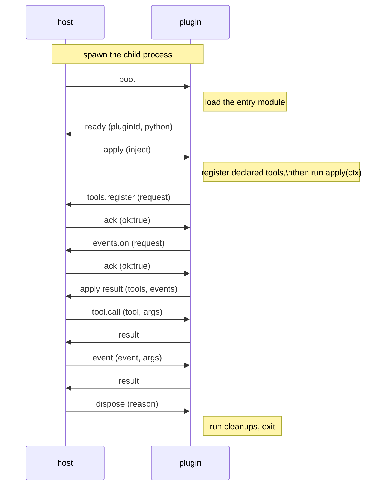

# dsh-mloader Python plugin ABI v1

English | [简体中文](PyABI.zh.md)

This document is the normative contract for a Python plugin and for the Python backend that hosts it. The shared contract is in [ABI-unified](../ABI-unified.md): the manifest schema, discovery, the capability whitelist, the operation payloads, the lifecycle, the security model and the installation layout. The package layout is in [Python package](Package.md), and the archive and installation rules it shares with every package are in [shared package](../Package.md).

The protocol version is 1. A change to a frame shape, a manifest field or the capability whitelist is a contract change; this document changes when the Python side of that contract changes.

## Contents

- [1. Runtime package](#1-runtime-package)
- [2. Entry module](#2-entry-module)
- [3. Registration styles](#3-registration-styles)
- [4. Result schema inference](#4-result-schema-inference)
- [5. Runtime errors](#5-runtime-errors)
- [6. Process transport and handshake](#6-process-transport-and-handshake)
- [7. Deadlines and failures](#7-deadlines-and-failures)
- [8. Reload and bytecode](#8-reload-and-bytecode)

## 1. Runtime package

### 1.1 Import name and licensing

The runtime ships in the loader repository under `src/runtime/python_sdk/` and is additionally MIT licensed. It is a flat package with import name `dsh_mloader_sdk`, standard library only, requiring Python 3.10 or later. It is split into the modules `channel`, `context`, `errors`, `runtime` and `version`. It also carries the packaging command line described in [Python package](Package.md) section 6, in the modules `cli`, `dependencies`, `environment`, `packaging`, `trash`, `run_cli` and `__main__`; those modules are not part of the plugin import surface. Plugin code normally imports the public names from the package root, and those modules are also importable directly, for example `from dsh_mloader_sdk.context import Context`.

The package has no `pyproject.toml` of its own. The loader installs a copy into the profile environment through a generated wheel and exposes the `dsh-mloader-sdk` command; the separate repository `dsh-mloader-python-sdk` carries the distribution metadata, mirrors this directory and is the distribution a plugin author may depend on. The copy in the loader is authoritative at run time.

### 1.2 Public names

Public names exported by `dsh_mloader_sdk`:

| Name | Kind | Purpose |
| --- | --- | --- |
| `plugin` | decorator | Marks the entry function `apply(ctx)`. |
| `tool` | decorator | Declares a tool without an `apply` function. |
| `ctx` | proxy | The capability context. An attribute lookup is forwarded to the active context, and it raises `HostUnavailable` before boot. |
| `get_context()` | function | Returns the active `Context`, or `None` before boot. |
| `Context` | class | Type of the context object, for annotations. |
| `PluginCallError` | exception | The host rejected a request, for example an invalid registration. |
| `HostUnavailable` | exception | The host channel is closed, or `ctx` is used outside a running plugin process. |
| `PROTOCOL_VERSION` | integer | Wire protocol version, currently `1`. |
| `__version__` | string | Version of the SDK package. |

Both registration styles derive the result schema from the handler's return annotation when no `output` is given; section 4 states the mapping.

### 1.3 Launch

The loader starts a Python plugin with the shared interpreter of the profile:

```sh
<profile>/mloader/.venv/bin/python -u <loader>/src/runtime/python_sdk/launch.py <plugin entry>
```

On Windows the interpreter is `<profile>/mloader/.venv/Scripts/python.exe`. The environment is created from the configured `pythonBin` with uv before the first Python plugin starts, as specified in [Python package](Package.md) section 5. When the loader does not manage a profile environment, it starts the configured `pythonBin` directly.

The plugin base directory is the working directory. `launch.py` reconfigures the three standard streams to UTF-8, loads the package from the directory that contains it and registers it in `sys.modules`, so `from dsh_mloader_sdk import ...` resolves to the copy shipped beside `launch.py` even when a package with the same name is installed in the interpreter. It then inserts the directory of the entry file at the front of `sys.path` and hands control to the runtime.

## 2. Entry module

The manifest `entry` field names the entry file. Discovery resolves it to an absolute path against the manifest directory, as specified in [ABI-unified](../ABI-unified.md) section 2.1.

- The entry file is loaded as a top level module named `dsh_user_plugin`.
- The directory of the entry file is on `sys.path`, so a module or a package beside the entry file is importable by its absolute name.
- A relative import such as `from .module import add` fails with `ImportError: attempted relative import with no known parent package`, because the entry file is not loaded as part of a package.
- A module level `apply` function is honored when it is not decorated with `@plugin`. A decorated entry function takes precedence over a plain `apply`.
- `@plugin(name="...")` is accepted for readability but has no effect: the manifest is the identity authority.
- A module level `TOOLS` list is honored. Each entry requires `name`, `description` and `handler`; `parameters`, `output` and `timeoutMs` are optional.

The package layout implications are specified in [Package](Package.md) section 1.

## 3. Registration styles

### 3.1 Style A: Cordis aligned

The plugin exports an entry function and registers capabilities inside it. Annotating the context as `Context` gives static tools the information needed for completion and API documentation.

```python
from dsh_mloader_sdk import Context, plugin

NAME = "my-plugin"

@plugin
def apply(ctx: Context):
    ctx.logger.info("my-plugin mounted")

    @ctx.tools.register(
        name="greet",
        description="Greet one person.",
        parameters={
            "type": "object",
            "properties": {"who": {"type": "string"}},
            "required": ["who"],
            "additionalProperties": False,
        },
    )
    def greet(args):
        return {"text": f"hello {args['who']}"}

    @ctx.on("tools/execute")
    def observe(payload):
        ctx.logger.debug(f"tool executed: {payload}")

    ctx.effect.register("cleanup", lambda: ctx.logger.info("my-plugin unloading"))
```

### 3.2 Style B: declarative

The plugin declares tools as decorated functions and needs no entry function.

```python
from dsh_mloader_sdk import tool

@tool(
    name="add",
    description="Add two numbers.",
    parameters={
        "type": "object",
        "properties": {"a": {"type": "number"}, "b": {"type": "number"}},
        "required": ["a", "b"],
        "additionalProperties": False,
    },
)
def add(args):
    return {"sum": args["a"] + args["b"]}
```

`@tool` takes the name as its first positional argument and the description as its second, so a call that supplies only a description fails at import time. The keyword form in the example is equivalent.

### 3.3 Mixing and ordering

Both styles may be mixed in one plugin. Declared tools are registered first, then the entry function runs. A registration request is synchronous: it returns after the host acknowledged it, and a rejection raises `PluginCallError` at the call site. A failed apply handshake stops the process.

### 3.4 The context surface

`apply(ctx)` receives one `Context` with four namespaces, and `ctx` from the package root proxies the same object.

| Namespace | Call | Contract |
| --- | --- | --- |
| `ctx.tools` | `register(name, description, parameters=None, output=None, timeout_ms=None)` | Returns a decorator that records the handler under `name`. The tool payload is specified in [ABI-unified](../ABI-unified.md) section 3.2. |
| `ctx.on` | `on(event)` or `ctx.on(event)` | Returns a decorator that subscribes the handler to one whitelisted event. The whitelist, the arity rules and the fire-and-forget rule are in section 3.3 of the same document. |
| `ctx.logger` | `debug`, `info`, `warn`, `error` with `(message, data=None)` | Sends a one-way notification. It never waits for a reply and never raises. It is the only route from a plugin to the loader logger, and it stays available while a cleanup runs. |
| `ctx.effect` | `register(label, cleanup=None)` | Records a cleanup that runs when the plugin is disposed. Cleanups run in reverse registration order, and one failing cleanup does not stop the rest. |

A tool handler is called with one argument, the object the model supplied. It must return a JSON serialisable value; the declared `output` schema or the inferred one validates it. An event handler follows the arity rule in [ABI-unified](../ABI-unified.md) section 3.3: zero parameters calls it with no argument, one parameter passes the first projected argument, and more than one passes every projected argument.

## 4. Result schema inference

The host validates a tool result against the declared `output` schema, and the default schema describes an object. A handler that returns a bare string, number or boolean therefore fails validation after it has run, with an error that names the value rather than the missing declaration. The Python runtime avoids that failure by deriving the schema from the handler's return annotation.

Inference applies only to `ctx.tools.register` and `@tool` calls that omit `output`, and only when the handler carries a return annotation. It covers these shapes:

| Annotation | Inferred schema |
| --- | --- |
| `str` | `{"type": "string"}` |
| `int` | `{"type": "integer"}` |
| `float` | `{"type": "number"}` |
| `bool` | `{"type": "boolean"}` |
| `dict` | `{"type": "object"}` |
| `list` | `{"type": "array"}` |
| `list[T]` | `{"type": "array", "items": <schema for T>}` |
| `tuple[T, ...]` | `{"type": "array", "items": <schema for T>}` |
| `Optional[T]` | The schema for `T`. |
| `Union[T, U]` | `{"oneOf": [<schema for T>, <schema for U>]}` |

A handler with no annotation, an annotation of `Any`, or an annotation this table cannot express keeps the host default, so the tool behaves exactly as it would without inference. Inference reads the annotation once during registration and never inspects a returned value, so it costs nothing at call time and cannot disagree with a handler whose return type varies.

An annotation that fails to resolve, for example a forward reference to a name the module does not define, counts as a missing annotation. The registration proceeds with the host default instead of raising.

An explicit `output` argument always wins. A plugin that needs a schema the table cannot express, such as one carrying `required` or `enum` constraints, states it directly.

## 5. Runtime errors

| Situation | Behavior |
| --- | --- |
| A tool handler raises | The `tool.call` reply is `ok:false` with the exception message. The plugin process stays alive. |
| An unknown tool is called | The reply is `ok:false` with an error message naming the tool. |
| A registration is rejected | The call site inside `apply` raises `PluginCallError`. The apply handshake then fails. |
| The plugin module fails to import | The boot reply is `ok:false` with `import failed: ...`, and the process exits with status 1. |
| A cleanup raises | The traceback goes to the runtime diagnostics stream and the remaining cleanups still run. |
| An unsupported host operation arrives | The reply is `ok:false`. |

Plugin code cannot write to the protocol. The runtime detaches the process standard streams before the plugin module loads, and section 6.2 states what a plugin write reaches instead.

## 6. Process transport and handshake

### 6.1 Spawn and environment

- The command is `<shared python> -u <launch.py> <absolute entry>`, and the working directory is the plugin base directory. The shared interpreter is the profile environment of section 1.3 when the loader manages one, and `pythonBin` otherwise.
- Before the process starts, the loader runs the runtime command line to create the environment when needed and install the dependencies the plugin declares. The installer never imports plugin code.
- The process is long lived. It is not started per call.
- The child runs with `PYTHONUNBUFFERED=1`.
- When the shared environment is used, the child receives `VIRTUAL_ENV` and a `PATH` entry that puts the environment binaries first.
- The inherited environment is sanitized before the process starts: variables whose names match `KEY`, `PASSWORD`, `SECRET` or `TOKEN` (case-insensitive), and any variable starting with `DSH_`, are removed. The manifest `env` object is applied afterwards and may set any value, including `PATH`.
- The backend sets `PYTHONDONTWRITEBYTECODE=1` unless the loader option `enablePyc` is true. Section 8 states the reason and the trade-off.
- The file system and the network are not restricted. The process boundary isolates crashes, it does not isolate permissions; section 7 of [ABI-unified](../ABI-unified.md) states the security model.

### 6.2 Standard streams

- One JSON frame per line, UTF-8, terminated by `\n`. This is not the LSP `Content-Length` framing.
- The runtime owns the standard descriptors. Before the plugin module loads, it duplicates descriptors 0, 1 and 2 into private streams, points the originals at the null device, and replaces `sys.stdin`, `sys.stdout`, `sys.stderr` and their `__stdin__`, `__stdout__` and `__stderr__` aliases. The private stdout carries protocol frames, the private stdin carries host requests, and the private stderr carries runtime diagnostics that the loader logs at debug level.
- Plugin code writes to the null device through `print`, `sys.stdout` and `sys.stderr`, the `logging` and `warnings` modules, a stream captured before the detachment, `os.write`, and a child process that inherits a standard descriptor. Log output reaches the loader only through `ctx.logger`.
- The launcher reconfigures the standard streams to UTF-8 before the runtime duplicates them, and every private stream is UTF-8. `PYTHONIOENCODING` and the locale therefore cannot select another codec. A byte that is not valid UTF-8 decodes to the replacement character, which leaves a line the runtime skips, and a character UTF-8 cannot carry is written as a backslash escape, which keeps a frame parseable.
- The detachment is a capability boundary for ordinary output, not a security sandbox. Deliberate code in the plugin process can still open files or a terminal device and reconnect descriptors, and the file system and the network remain unrestricted as section 6.1 states.

The frame shapes, the operation payloads and the reply rules are specified in [ABI-unified](../ABI-unified.md) section 4.

### 6.3 Handshake sequence



Registration is host executed: the plugin requests it, and the host performs the real registration and records the disposer in the plugin's ledger.

The runtime does not validate the manifest. Manifest validation happens during discovery in the loader, before a backend instance exists. The boot step only loads the plugin entry module and replies with the plugin id and the Python version.

## 7. Deadlines and failures

| Situation | Behavior |
| --- | --- |
| `boot` or `apply` exceeds `startupMs` (default 10000 ms) | The loader kills the process and marks the plugin `failed`. Other plugins are unaffected. |
| `tool.call` or event delivery exceeds `callMs` (default 30000 ms) | The call returns an error and the process stays alive. A tool timeout does not kill the plugin. |
| The process crashes, including `os._exit()` | The plugin's registrations are revoked and its state becomes `failed`. dsh and the other plugins continue. |
| A plugin request is invalid | It is rejected with `ok:false`, and the plugin can observe the rejection. |
| A frame cannot be delivered | The request fails immediately with a `transport` error instead of waiting for the timeout. |
| A non-protocol line appears on `stdout` | The line is skipped and a warning is logged. This is a defence for output that bypassed the runtime, not a plugin output route. |
| `dispose` does not answer within 1000 ms | The loader sends SIGTERM, waits at most 2000 ms, then sends SIGKILL. |

The two deadlines come from the manifest: `timeouts.startupMs` covers `boot` and `apply`, and `timeouts.callMs` covers `tool.call` and event delivery.

## 8. Reload and bytecode

A reload stops the old process and starts a new one. The new process imports the entry module again, so module level state does not survive a reload. A crashed plugin is not restarted automatically; section 5 of [ABI-unified](../ABI-unified.md) states the lifecycle rules.

CPython caches the compiled entry file beside it in `__pycache__` and decides whether a cache entry still matches the source by the source mtime in whole seconds plus the source size. Neither input changes when an edit keeps the file the same length and lands inside the same second, which is easy to hit when two equal length literals are swapped or a value is retyped in place. A reload would then start a child that loads the previous code and reports success, so the failure is silent. The backend therefore spawns the child with `PYTHONDONTWRITEBYTECODE=1` unless `enablePyc` is true. The operator trade-off is recorded in [CONTEXT](../../CONTEXT.md#the-bytecode-cache-enablepyc).
