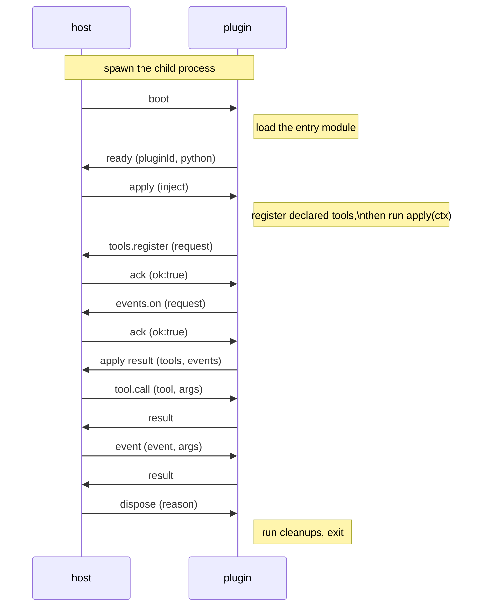

# dsh-mloader Python 插件 ABI v1

[English](PyABI.md) | 简体中文

本文是 Python 插件及托管它的 Python 后端的规范契约。共享契约见 [ABI-unified](../ABI-unified.zh.md)：清单 schema、发现、能力白名单、操作载荷、生命周期、安全模型和安装布局。包布局见 [Python 包](Package.zh.md)，它与所有包共用的归档和安装规则见 [共享包](../Package.zh.md)。

协议版本是 1。修改帧形状、清单字段或能力白名单都是契约变更；Python 这一侧的契约变化会更新本文。

## 目录

- [1. 运行时包](#1-运行时包)
- [2. 入口模块](#2-入口模块)
- [3. 注册风格](#3-注册风格)
- [4. 结果 schema 推断](#4-结果-schema-推断)
- [5. 运行时错误](#5-运行时错误)
- [6. 进程传输与握手](#6-进程传输与握手)
- [7. 截止时间与失败](#7-截止时间与失败)
- [8. 重新加载与字节码](#8-重新加载与字节码)

## 1. 运行时包

### 1.1 导入名与许可证

运行时随加载器仓库一起发布，位于 `src/runtime/python_sdk/`，并额外采用 MIT 许可证。它是一个扁平包，导入名是 `dsh_mloader_sdk`，只用标准库，要求 Python 3.10 或更高版本。它分为 `channel`、`context`、`errors`、`runtime` 和 `version` 模块。它还携带 [Python 包](Package.zh.md) 第 6 节描述的打包命令行，即 `cli`、`dependencies`、`environment`、`packaging`、`trash`、`run_cli` 和 `__main__` 模块；这些模块不属于插件导入面。插件代码通常从包根导入公共名称，这些模块也可以直接导入，例如 `from dsh_mloader_sdk.context import Context`。

这个包本身没有 `pyproject.toml`。加载器通过生成的 wheel 把副本安装进 profile 环境，并提供 `dsh-mloader-sdk` 命令；单独的仓库 `dsh-mloader-python-sdk` 携带分发元数据、镜像这个目录，是插件作者可以依赖的分发物。加载器里的副本在运行时是权威。

### 1.2 公共名称

`dsh_mloader_sdk` 导出的公共名称：

| 名称 | 种类 | 用途 |
| --- | --- | --- |
| `plugin` | 装饰器 | 标记入口函数 `apply(ctx)`。 |
| `tool` | 装饰器 | 在没有 `apply` 函数时声明工具。 |
| `ctx` | 代理 | 能力上下文。属性查找转发给活动上下文，在启动前抛 `HostUnavailable`。 |
| `get_context()` | 函数 | 返回活动的 `Context`，启动前返回 `None`。 |
| `Context` | 类 | 上下文对象的类型，用于注解。 |
| `PluginCallError` | 异常 | 宿主拒绝了请求，例如非法注册。 |
| `HostUnavailable` | 异常 | 宿主通道已关闭，或在运行中的插件进程之外使用 `ctx`。 |
| `PROTOCOL_VERSION` | 整数 | 线上协议版本，当前为 `1`。 |
| `__version__` | 字符串 | SDK 包的版本。 |

两种注册风格在没有给 `output` 时，都会从处理器的返回注解推导结果 schema；第 4 节说明映射。

### 1.3 启动

加载器用 profile 的共享解释器启动 Python 插件：

```sh
<profile>/mloader/.venv/bin/python -u <loader>/src/runtime/python_sdk/launch.py <plugin entry>
```

Windows 下解释器是 `<profile>/mloader/.venv/Scripts/python.exe`。环境在第一个 Python 插件启动前由配置的 `pythonBin` 用 uv 创建，见 [Python 包](Package.zh.md) 第 5 节。加载器不管理 profile 环境时，直接启动配置的 `pythonBin`。

插件基目录是工作目录。`launch.py` 先把三个标准流重新配置为 UTF-8，再从它所在目录加载包并注册到 `sys.modules`，所以 `from dsh_mloader_sdk import ...` 解析到 `launch.py` 旁边的副本，即使解释器里装了同名包。然后它把入口文件所在目录插到 `sys.path` 最前面，把控制权交给运行时。

## 2. 入口模块

清单的 `entry` 字段指定入口文件。发现过程按清单目录把它解析为绝对路径，见 [ABI-unified](../ABI-unified.zh.md) 第 2.1 节。

- 入口文件作为名为 `dsh_user_plugin` 的顶层模块加载。
- 入口文件所在目录在 `sys.path` 上，所以入口旁边的模块或包可以用绝对名导入。
- 相对导入如 `from .module import add` 会失败，报 `ImportError: attempted relative import with no known parent package`，因为入口文件不是作为包的一部分加载的。
- 模块级 `apply` 函数在没有 `@plugin` 装饰时也会被采用。被装饰的入口函数优先于普通 `apply`。
- `@plugin(name="...")` 只是为了可读性而接受，没有效果：清单是身份权威。
- 模块级 `TOOLS` 列表也会被采用。每一项需要 `name`、`description` 和 `handler`；`parameters`、`output` 和 `timeoutMs` 可选。

包布局的影响见 [Package](Package.zh.md) 第 1 节。

## 3. 注册风格

### 3.1 风格 A：Cordis 对齐

插件导出一个入口函数，并在其中注册能力。

```python
from dsh_mloader_sdk import plugin

NAME = "my-plugin"

@plugin
def apply(ctx):
    ctx.logger.info("my-plugin mounted")

    @ctx.tools.register(
        name="greet",
        description="Greet one person.",
        parameters={
            "type": "object",
            "properties": {"who": {"type": "string"}},
            "required": ["who"],
            "additionalProperties": False,
        },
    )
    def greet(args):
        return {"text": f"hello {args['who']}"}

    @ctx.on("tools/execute")
    def observe(payload):
        ctx.logger.debug(f"tool executed: {payload}")

    ctx.effect.register("cleanup", lambda: ctx.logger.info("my-plugin unloading"))
```

### 3.2 风格 B：声明式

插件把工具声明为被装饰的函数，不需要入口函数。

```python
from dsh_mloader_sdk import tool

@tool(
    name="add",
    description="Add two numbers.",
    parameters={
        "type": "object",
        "properties": {"a": {"type": "number"}, "b": {"type": "number"}},
        "required": ["a", "b"],
        "additionalProperties": False,
    },
)
def add(args):
    return {"sum": args["a"] + args["b"]}
```

`@tool` 把名称作为第一个位置参数、描述作为第二个，所以只给描述会在导入时失败。示例里的关键字形式等价。

### 3.3 混用与顺序

两种风格可以在一个插件里混用。声明的工具先注册，然后入口函数运行。注册请求是同步的：宿主确认后才返回，被拒绝时在调用点抛 `PluginCallError`。apply 握手失败会停止进程。

### 3.4 上下文接口

`apply(ctx)` 收到一个 `Context`，包含四个命名空间；包根的 `ctx` 代理同一个对象。

| 命名空间 | 调用 | 约定 |
| --- | --- | --- |
| `ctx.tools` | `register(name, description, parameters=None, output=None, timeout_ms=None)` | 返回一个装饰器，把处理器记录在 `name` 下。工具载荷见 [ABI-unified](../ABI-unified.zh.md) 第 3.2 节。 |
| `ctx.on` | `on(event)` 或 `ctx.on(event)` | 返回一个装饰器，把处理器订阅到一个白名单事件。白名单、参数个数规则和 fire-and-forget 规则在同一文档第 3.3 节。 |
| `ctx.logger` | `debug`、`info`、`warn`、`error`，参数为 `(message, data=None)` | 发送单向通知。从不等待回复，也从不抛异常。 |
| `ctx.effect` | `register(label, cleanup=None)` | 记录一个在插件销毁时运行的清理函数。清理按注册的逆序运行，一个清理失败不会阻止其余清理。 |

工具处理器接收一个参数，即模型提供的对象。它必须返回可 JSON 序列化的值；声明的 `output` schema 或推导出的 schema 会校验它。事件处理器遵循 [ABI-unified](../ABI-unified.zh.md) 第 3.3 节的参数个数规则：零个参数时不传参数调用，一个参数时传第一个投影参数，多于一个时传所有投影参数。

## 4. 结果 schema 推断

宿主按声明的 `output` schema 校验工具结果，默认 schema 描述对象。因此返回裸字符串、数字或布尔值的处理器会在运行后校验失败，错误指向值而不是缺失的声明。Python 运行时通过从处理器的返回注解推导 schema 来避免这种失败。

推导只适用于省略 `output` 的 `ctx.tools.register`、`@tool` 和 `TOOLS` 列表项，并且只在处理器带返回注解时运行。它覆盖这些形状：

| 注解 | 推导出的 schema |
| --- | --- |
| `str` | `{"type": "string"}` |
| `int` | `{"type": "integer"}` |
| `float` | `{"type": "number"}` |
| `bool` | `{"type": "boolean"}` |
| `dict` | `{"type": "object"}` |
| `list` | `{"type": "array"}` |
| `list[T]` | `{"type": "array", "items": <schema for T>}` |
| `tuple[T, ...]` | `{"type": "array", "items": <schema for T>}` |
| `Optional[T]` | `T` 的 schema。 |
| `Union[T, U]` | `{"oneOf": [<schema for T>, <schema for U>]}` |

没有注解、注解为 `Any`，或注解无法用这张表表达时，处理器保留宿主默认值，工具行为与没有推导时完全相同。推导在注册时读取一次注解，从不在调用时检查返回值，所以调用时没有成本，也不会与返回类型会变化的处理器产生分歧。

无法解析的注解，例如前向引用到模块未定义的名字，视为没有注解。注册继续使用宿主默认值，而不是抛错。

显式 `output` 参数总是优先。需要这张表无法表达的 schema 的插件，例如带 `required` 或 `enum` 约束的，直接声明它。

## 5. 运行时错误

| 情况 | 行为 |
| --- | --- |
| 工具处理器抛异常 | `tool.call` 回复是 `ok:false`，带异常消息。插件进程继续存活。 |
| 调用未知工具 | 回复是 `ok:false`，错误消息会指出该工具。 |
| 注册被拒绝 | `apply` 里的调用点抛 `PluginCallError`。apply 握手随后失败。 |
| 插件模块导入失败 | 启动回复是 `ok:false`，带 `import failed: ...`，进程以状态 1 退出。 |
| 清理函数抛异常 | traceback 写到 `stderr`，其余清理仍然运行。 |
| 收到不支持的宿主操作 | 回复 `ok:false`。 |

`stdout` 只属于协议。不是 JSON 的杂散行会被跳过并在 `stderr` 报告。

## 6. 进程传输与握手

### 6.1 启动与环境

- 命令是 `<shared python> -u <launch.py> <absolute entry>`，工作目录是插件基目录。加载器管理 profile 环境时，共享解释器是第 1.3 节的 profile 环境；否则是 `pythonBin`。
- 进程启动前，加载器运行运行时命令行，按需创建环境并安装插件声明的依赖。安装器从不导入插件代码。
- 进程是长生命周期的。它不是每次调用都启动。
- 子进程以 `PYTHONUNBUFFERED=1` 运行。
- 使用共享环境时，子进程会收到 `VIRTUAL_ENV`，以及把环境二进制目录放在最前面的 `PATH` 条目。
- 进程启动前会清理继承的环境：名字匹配 `KEY`、`PASSWORD`、`SECRET` 或 `TOKEN`（不区分大小写）的变量，以及任何以 `DSH_` 开头的变量都会被移除。清单的 `env` 对象随后应用，可以设置任何值，包括 `PATH`。
- 除非加载器选项 `enablePyc` 为 true，后端会设置 `PYTHONDONTWRITEBYTECODE=1`。第 8 节说明原因和取舍。
- 文件系统和网络不受限制。进程边界隔离崩溃，不隔离权限；[ABI-unified](../ABI-unified.zh.md) 第 7 节说明安全模型。

### 6.2 标准流

- 每行一个 JSON 帧，UTF-8，以 `\n` 结尾。这不是 LSP 的 `Content-Length` 分帧。
- `stdout` 是协议通道。诊断写到 `stderr`，加载器把它转发给日志器。
- 运行时在读写任何帧之前把 `stdin`、`stdout` 和 `stderr` 重新配置为 UTF-8，所以 `PYTHONIOENCODING` 和 locale 不能选择其他编解码器。不是合法 UTF-8 的字节会解码为替换字符，运行时跳过该行；UTF-8 无法承载的字符会写成反斜杠转义，保持帧可解析。
- `stdout` 上的非协议行会被跳过并在 `stderr` 报告；不会让插件失败。

帧形状、操作载荷和回复规则见 [ABI-unified](../ABI-unified.zh.md) 第 4 节。

### 6.3 握手序列



注册由宿主执行：插件提出请求，宿主执行真正的注册，并把 disposer 记录到插件的账本。

运行时不做清单校验。清单校验发生在加载器的发现阶段，早于后端实例存在。启动步骤只加载插件入口模块，并回复插件 id 和 Python 版本。

## 7. 截止时间与失败

| 情况 | 行为 |
| --- | --- |
| `boot` 或 `apply` 超过 `startupMs`（默认 10000 ms） | 加载器杀死进程并把插件标记为 `failed`。其他插件不受影响。 |
| `tool.call` 或事件投递超过 `callMs`（默认 30000 ms） | 调用返回错误，进程继续存活。工具超时不会杀死插件。 |
| 进程崩溃，包括 `os._exit()` | 插件的注册被撤销，状态变为 `failed`。dsh 和其他插件继续运行。 |
| 插件请求非法 | 以 `ok:false` 拒绝，插件可以看到拒绝。 |
| 帧无法送达 | 请求立即以 `transport` 错误失败，而不是等超时。 |
| `stdout` 上出现非协议行 | 跳过该行并记录警告。插件继续运行。 |
| `dispose` 在 1000 ms 内没有回复 | 加载器发送 SIGTERM，最多等 2000 ms，然后发送 SIGKILL。 |

两个截止时间来自清单：`timeouts.startupMs` 覆盖 `boot` 和 `apply`，`timeouts.callMs` 覆盖 `tool.call` 和事件投递。

## 8. 重新加载与字节码

重新加载会停止旧进程并启动新进程。新进程重新导入入口模块，所以模块级状态不会跨重新加载保留。崩溃的插件不会自动重启；[ABI-unified](../ABI-unified.zh.md) 第 5 节说明生命周期规则。

CPython 把编译后的入口文件缓存到旁边的 `__pycache__`，并用源文件整秒级 mtime 加源文件大小判断缓存是否仍匹配。编辑后文件长度不变且落在同一秒内时，这两个输入都不变，两个等长字面量互换或原地改写一个值时很容易命中。重新加载随后会启动一个加载旧代码的子进程并报告成功，失败是静默的。因此后端在 `enablePyc` 不为 true 时用 `PYTHONDONTWRITEBYTECODE=1` 启动子进程。操作者的取舍记录在 [CONTEXT](../../CONTEXT.md#the-bytecode-cache-enablepyc)。
